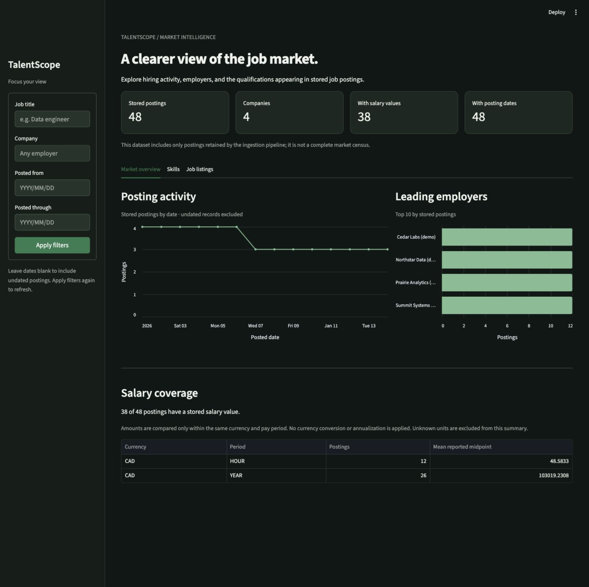

# TalentScope

A dashboard for exploring job postings, employers, salaries, and skills.

**Built with:** Python, pandas, PostgreSQL, AWS S3, Streamlit, and Docker.

## Preview

The screenshot uses fictional demo postings.



## Explore the job market

- **Hiring activity:** filter postings by role, employer, and date, then explore trends and leading companies.
- **Salary comparisons:** group amounts by currency and pay period instead of mixing hourly and annual figures.
- **Skill mentions:** extract a defined set of technologies from qualification text.

## From job listings to charts

JSearch API → S3 raw JSON → pandas processing → PostgreSQL → Streamlit dashboard.
Raw pages can be processed again without duplicating job records.

## Open the dashboard

With Docker installed, set a local database password and start the app:

```sh
export DB_PASSWORD="$(openssl rand -hex 24)"
docker compose up --build -d --wait
```

Open [localhost:8501](http://localhost:8501). Keep the same password when reusing
the database. A fresh database starts with an empty dashboard.

## What is verified

The local pipeline has been tested; live API/AWS validation is pending.
See [setup](docs/local-setup.md) and [testing](docs/integration-validation.md) for details.
